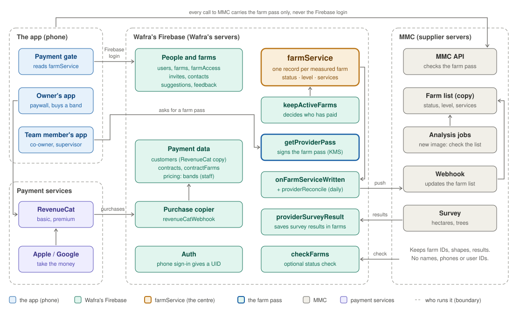
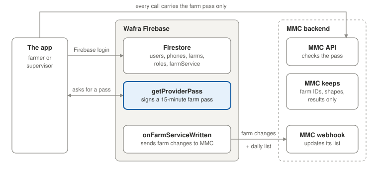

# Service architecture

*How the Wafra Farm App's services fit together, and how data moves between them. Wafra owns the Firebase
projects and the database rules. Status: rules, indexes and RevenueCat are live on staging and production;
the Cloud Functions go live once the Blaze plan is on and the setup in [section 7](#7-setting-up-a-project)
is done.*



## 1. The four pieces

| Piece | What it does | Run by |
|---|---|---|
| **The app** | what farmers use on their phones | built by MMC's engineers, owned by Wafra |
| **Wafra's Firebase** | sign-in, the database, Wafra's Cloud Functions | Wafra |
| **RevenueCat** | in-app payments through Apple and Google | Wafra |
| **The analytics provider** (MMC) | measures farms from satellite images, maps, advice | MMC |

**Where data lives.** Everything about people stays in Wafra's Firebase: names, phone numbers, user IDs,
farms, roles, contacts, payments (a copy), contracts and prices. The provider keeps farms only: its own farm
ID, the farm's shape and its results. It has no login to Wafra's Firebase, and it never sees a user ID, a
phone number or a Firebase token.

## 2. How data moves

1. **Sign in.** Phone number and SMS code (Firebase Auth). The person's user ID is also their RevenueCat ID.
2. **Add a farm.** The app saves the farm and its boundary in Firebase (`farms`). Wafra's function sends the
   boundary to the provider to survey; the provider sends back what it measured (its farm ID, hectares and
   tree count) to another Wafra function, which saves it. A new boundary drawing does the same.
3. **Pay.** The app works out the price (section 3) and the farmer pays through Apple or Google. RevenueCat's
   ready-made Firebase add-on copies the purchase into Firebase (`customers/{userId}`).
4. **The farm list.** `keepActiveFarms` keeps `farmService` up to date: one record per measured farm, saying
   `active`, `readonly` or `removed`, its level and its services. It runs whenever a purchase, a farm, a
   contract or the prices change, and once a day.
5. **The provider's copy.** Each change in `farmService` is pushed to the provider, and the full list once a
   day. The provider computes only `active` farms, for their level and services.
6. **Use the farm.** The app checks `farmService/{farmId}`: `active` farms are active, the rest read-only.
   To show maps and advice, the app gets a **farm pass** from Wafra and calls the provider with it.
7. **Contracts** (governments, big clients). Wafra adds the contract and its farm list (by owner's phone
   number). When the owner signs up, the app finds their farms by phone and creates them with the contract.
   They never see a payment screen.
8. **Team.** An owner or co-owner creates an invitation code. The person invited enters it, and the app adds
   them to the farm (`farmAccess`). Their farm pass then lists that farm.

## 3. Prices

The numbers are in `pricing/current` in Firebase. The rules are:

- **Two plans:** Basic and Premium, each monthly or yearly. What a farm gets follows what is on it: crop
  features if it has crops, tree features if it has trees.
- **Crops are priced per hectare, trees per tree.** Trees are never counted as hectares. For all the
  owner's farms together: monthly total = crop hectares × the rate per hectare + trees × the rate per tree.
  The rate per hectare depends on the owner's total hectares, the rate per tree on his total trees.
  Minimums: 1 hectare of crops, 100 trees.
- **One list of price bands.** The total is **always rounded down** to a band: the highest band whose
  monthly price is at or below it. A total below the first band pays the first band (the minimum bill).
- **Each band is one store product** per level and period: `wafra_premium_m_012` is Premium, monthly, band 12
  (`basic` for Basic, `y` for yearly).
- **Every plan starts with a 30-day free trial** (the stores' introductory offer). On Apple, all products sit
  in one subscription group; on Google Play the offer is for people who never had a subscription in the app.
  So moving between levels or bands never gives a second trial.
- **In the app:** up to 10 farms, 25 ha and 1,000 trees per farm. Bigger clients get a contract and an invoice.
- **If a farm grows** past the band the owner pays for, it stays active for 14 days, then becomes read-only
  until the owner moves to the right band. Bands are compared, not dollar sums, because of the rounding down.
- **RevenueCat:** entitlements `basic` and `premium`; offering `wafra` (a fallback the SDK expects; the app
  picks the product by band from `pricing/current`).

`firebase/functions/pricing.js` has these rules as code. The app uses the same rules.

## 4. Roles

| | Owner | Co-owner | Supervisor |
|---|---|---|---|
| Sees the farm, maps and advice | yes | yes | yes |
| Edits the farm | yes | yes | redraws boundaries only |
| Invites people, sends advice on | yes | yes | no |
| Pays | yes | no | no |

A role belongs to a person on one farm. A supervisor can work on several farms, of one owner or of many.
At the provider every role has `edit` access today (redraw a boundary, correct a tree, send a plant photo);
paying, inviting and sending advice never involve the provider.

## 5. Firebase

| | Staging | Production |
|---|---|---|
| Project | `wafra-farm-staging` | `wafra-farm-production` |
| Use | testing | real farmers |
| Test phone numbers | +15555550101 to +15555550103, code `123456` | none |

The files are in [`firebase/`](firebase/): the database rules (`firestore.rules`), the indexes, and the
functions (`functions/`). The fields of every collection are in [`FIRESTORE_SCHEMA.md`](FIRESTORE_SCHEMA.md).

| Function | Starts when | What it does |
|---|---|---|
| `onCustomerWritten`, `onFarmWritten`, `onContractWritten`, `onPricingWritten`, `daily` | a purchase, farm, contract or price changes; 00:30 UTC | `keepActiveFarms`: keeps `farmService` right. `onFarmWritten` also asks the provider to survey a new boundary. |
| `getProviderPass` | the app calls it | gives the signed-in person a 15-minute farm pass |
| `providerKeys` | the provider reads it | Wafra's public keys (JWKS) to check farm passes |
| `onFarmServiceWritten` | a `farmService` record changes | pushes the change to the provider |
| `providerReconcile` | 01:00 UTC | pushes the full list to the provider |
| `providerSurveyResult` | the provider calls it | saves a survey result in `farms` |
| `checkFarms` | the provider calls it (optional) | confirms farms' status before a costly job |

To deploy (from the repository root, after `npx firebase-tools login`):

```bash
npx firebase-tools deploy --project staging --config docs/service-architecture/firebase/firebase.json
```

Staging first, then the same command with `--project production`. The functions and RevenueCat's add-on need
Firebase's Blaze plan, and the setup in section 7.

**Never in the repository:** service-account keys, app config files, secrets, and Wafra's price sheet
(`private/`).

## 6. The provider link



Two questions, two paths:

| Question | Who asks | Answer |
|---|---|---|
| Who may **see** this farm? | the app, when a person opens a farm | the farm pass |
| Should the provider **compute** this farm? | the provider's jobs, with no person | the provider's copy of `farmService`, kept up to date by push |

**The farm pass.** The app calls `getProviderPass` (Firebase login, App Check). The function reads the
person's farms (owned, and `farmAccess` with `status: active`) and their `farmService` records, and returns a
JWT signed with RS256 by a Cloud KMS key, valid 15 minutes:

```json
{
  "iss": "wafra-staging",
  "aud": "mmc",
  "sub": "p_Qk2v…",
  "iat": 1792700000,
  "exp": 1792700900,
  "farms": [
    { "id": "<provider farm ID>", "access": "edit", "status": "active",
      "level": "premium", "services": ["crops"], "version": 12 }
  ]
}
```

- `sub` is a code name: an HMAC of the user ID with a secret per provider. It is stable, it is not the user
  ID, and Wafra can work it out again for support. Nothing is stored.
- `status: readonly` farms are in the pass: the provider shows their old results but computes nothing new.
  Removed farms and farms not yet measured are not.
- At most 50 farms. The app can ask for some farms only (`{ farmIds: [...] }`); `more: true` in the answer
  says there were more.
- The provider checks the signature with the keys at `providerKeys` (by `kid`), and checks `iss`, `aud` and
  `exp`. When the pass has a higher `version` for a farm than the provider's copy, the provider may update its
  copy from the pass.

**Messages to the provider** (`POST` to its webhook, with a Google ID token of Wafra's service account whose
audience is the webhook address):

| `type` | When | Body |
|---|---|---|
| `farm.activated`, `farm.updated`, `farm.deactivated`, `farm.removed` | a `farmService` record changes | `{ id, type, sentAt, farm }` |
| `farms.snapshot` | every day at 01:00 UTC, in pages of 500 | `{ id, type, sentAt, snapshot: { id, page, last }, farms: [...] }` |
| `survey.requested` | a new farm, or a new boundary version | `{ id, type, sentAt, survey: { requestId, providerFarmId, farmType, boundary: { version, points } } }` |

`farm` is `{ providerFarmId, status, level, services, boundaryVersion, version }`. The provider ignores a
message whose `id` it has seen, and a farm whose `version` is lower than its copy's. A failed message is
retried for up to a day; after that the daily snapshot repairs it. The provider replaces its list with a
snapshot once the page marked `last` has arrived.

**Calls from the provider** carry a Google ID token of the provider's own service account, with the Firebase
project ID as the audience. Any other caller is refused.

- `providerSurveyResult`: `{ requestId, providerFarmId, boundaryVersion, status: "done" | "failed",
  cropAreaHa, treeCount }`. Refused (409) if the boundary has changed since the request.
- `checkFarms` (optional): `{ farmIds: [providerFarmId, …] }`, at most 500; answers each farm's message, or
  `status: "unknown"`.

All that is particular to the provider is in `firebase/functions/providers/mmc.js`. Messages and passes use
Wafra's words (`basic`, `premium`, `crops`, `trees`); the provider maps them to its own products.

## 7. Setting up a project

Do each step in `wafra-farm-staging`, then in `wafra-farm-production`. The functions' settings are asked
for at the first deploy and saved in `functions/.env.<project>` (not committed).

1. **Blaze plan.**
2. **A service account for the functions**, e.g. `wafra-functions@<project>.iam.gserviceaccount.com`, with
   only: Cloud Datastore User (Firestore), Eventarc Event Receiver (the Firestore triggers), Logs Writer,
   and the rights in steps 3 and 4. Setting: `FUNCTIONS_SERVICE_ACCOUNT`.
3. **The signing key.** In Cloud KMS, a key ring in `me-central1` and a key `farm-pass`, purpose
   "asymmetric sign", algorithm `RSA_SIGN_PKCS1_2048_SHA256`. Give the functions' service account
   "Cloud KMS CryptoKey Signer" and "Cloud KMS CryptoKey Public Key Viewer" on that key only. Setting:
   `PASS_KMS_KEYS` = the full name of the key version (`projects/…/cryptoKeyVersions/1`). To change keys,
   add a version and put it first, keeping the old one listed until passes signed with it have expired.
4. **The code-name secret.** In Secret Manager, `PASS_SUB_SECRET_MMC` = 32 random bytes, stored in
   `me-central1` only (user-managed replication). Give the functions' service account "Secret Manager Secret
   Accessor" on it. Never change it: code names would change.
5. **Settings:** `PASS_ISSUER` (`wafra-staging` or `wafra-production`), `MMC_WEBHOOK_URL` (from MMC),
   `MMC_SERVICE_ACCOUNT` (the email of MMC's Google service account, from MMC).
6. **App Check** in the app (App Attest on iPhone, Play Integrity on Android): `getProviderPass` refuses calls
   without it. The app calls the functions in `me-central1` (for example `getFunctions(app, 'me-central1')`).
7. **Deploy** rules, indexes and functions (section 5). Give MMC: the `providerKeys` address, the
   `providerSurveyResult` and `checkFarms` addresses, the issuer, and the project ID (the audience of its
   calls).
